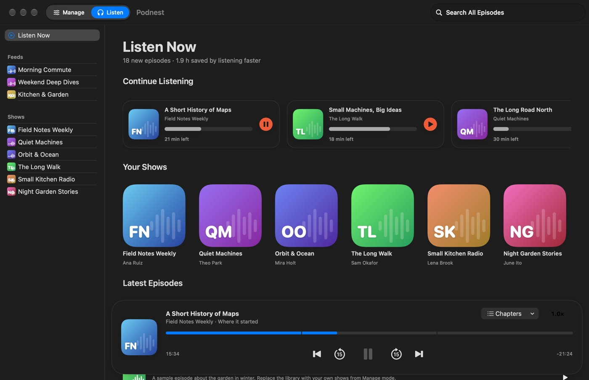
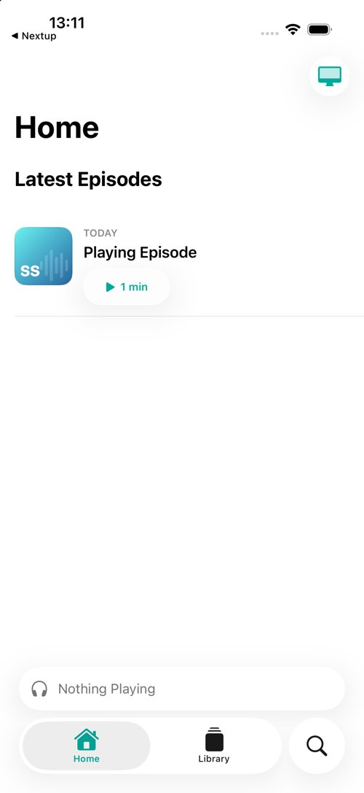
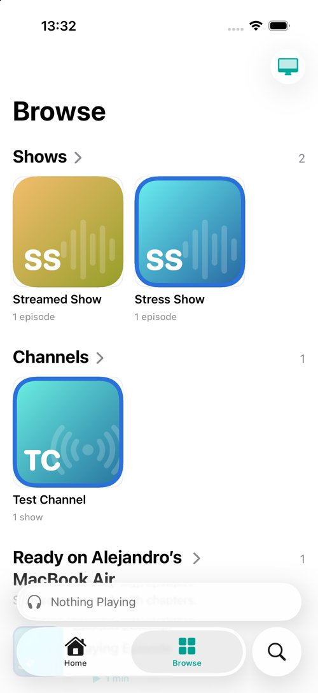
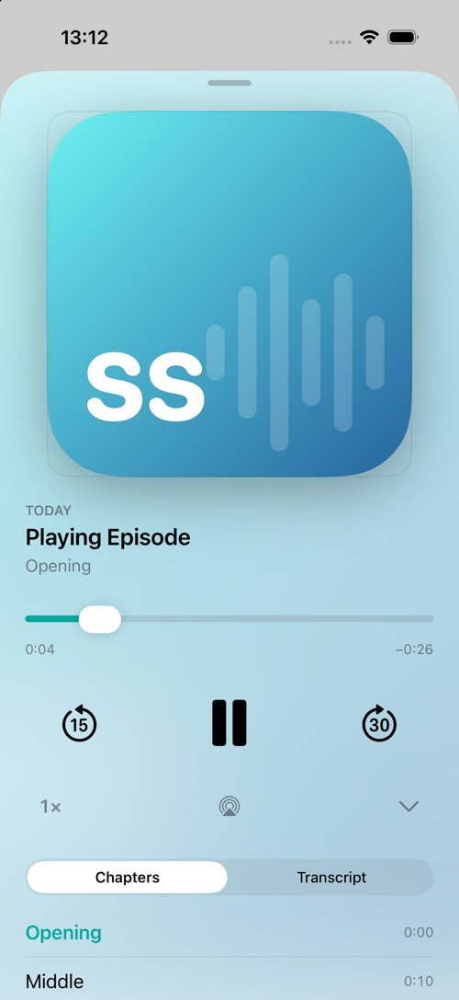
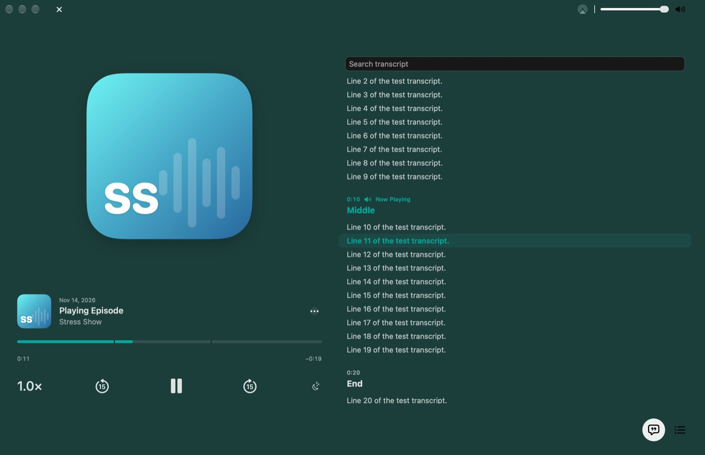

<div align="center">


# PodCraft

**A free podcast app for Mac and iPhone that cuts sponsors, adds chapters and transcripts, and keeps every device in sync.**

[](https://github.com/Alehaaaa/PodCraft/actions/workflows/ios-ipa.yml)
[](https://github.com/Alehaaaa/PodCraft/actions/workflows/macos-app.yml)


[Features](#features) · [Install](#install) · [Sync](#sync) · [Build from source](#build-from-source) · [Project layout](#project-layout)

</div>

---

<p align="center">
  
</p>

<p align="center">
  
  &nbsp;
  
  &nbsp;
  
</p>

## Features

### On the Mac

| | |
|---|---|
| 🎧 **Manage & Listen** | Two modes: one to organize shows, feeds and downloads, one built for listening. |
| ✂️ **Sponsor removal** | Finds sponsor reads on-device and cuts them out of the audio. You can review every cut on a waveform. YouTube sources also use the [SponsorBlock](https://sponsor.ajay.app) community database. |
| 📑 **Chapters** | Generates chapter titles on-device with Apple's Foundation Models and keeps YouTube chapters when a verified video source exists. |
| 📝 **Transcripts** | Transcribes episodes locally with Apple's speech recognition. Search the transcript and jump to any line while you listen. |
| 📺 **Video** | Optionally uses a show's official YouTube upload, but only after both the channel and the episode title and length match. |
| 📡 **Your own feeds** | Group shows into channels and serve the cleaned episodes as private RSS feeds that any podcast app can subscribe to. |
| 🔄 **Sync** | Joins the same [sync group](#sync) as your iPhones, so followed shows, progress and speed match everywhere. |
| 📱 **iPhone hosting** | Serves its library to the iPhone app over your network or [Tailscale](https://tailscale.com), and hosts the iPhone build as an AltStore source. |

<p align="center">
  
</p>

### On the iPhone

The iPhone app works in two ways, and you can switch between them at any time in **Settings → Listen From**.

| | **With your Mac** (companion) | **On its own** (standalone) |
|---|---|---|
| Where shows come from | PodCraft on your Mac | Apple's podcast directory, or any RSS feed you paste in |
| Sponsors cut, chapters, transcripts | ✅ | — (plays episodes as published) |
| Needs the Mac to be awake and reachable | Yes (same network or Tailscale) | No |
| Background audio, Lock Screen, AirPlay, speed | ✅ | ✅ |
| [Sync](#sync) across devices | ✅ | ✅ |

## Install

### iPhone, through AltStore or SideStore

Add this source:

```
https://raw.githubusercontent.com/Alehaaaa/PodCraft/main/altstore.json
```

Builds are unsigned. AltStore, SideStore and LiveContainer sign them when they install. Once PodCraft is installed, **Settings → Check for Updates** finds new releases on GitHub, or on your Mac in companion mode.

You can also download any `.ipa` directly from [`altstore/`](altstore) or from the artifacts of the [iOS IPA workflow](https://github.com/Alehaaaa/PodCraft/actions/workflows/ios-ipa.yml).

### Mac

There's no prebuilt Mac download yet. Build it from source, as described [below](#mac-app).

## Sync

Sync keeps **the shows you follow, where you are in every episode, and your playback speed** the same on your Mac and any number of iPhones. Each device can use a different mode. It's free, needs no account, and doesn't depend on Tailscale.

1. On one device, open **Settings → Sync → Start Syncing** (on the Mac: **Settings → iPhone & Sync**).
2. On each other device, scan the QR code with the Camera app or type the 16-character code.

How it works:

- Each device keeps its own entry in one shared document. For every show and episode, the newest change wins, so devices that were offline merge cleanly when they reconnect.
- The document is compressed and encrypted with **AES-GCM**, using a key derived from the sync code (HKDF-SHA256). It's stored in a free public text store ([textdb.dev](https://textdb.dev)) under a hashed name. The store only ever sees ciphertext, and nobody can find your document without the code.
- Positions are exchanged in the original recording's time, so progress on the Mac's sponsor-cut episodes lines up with phones that stream the feed directly. Shows unfollowed on another device stay on the Mac with their downloads.
- In **Settings → Sync** you can choose per device what it syncs, rename the device, see your other devices, or remove one.

> Anyone with your sync code can read and change your listening data, so share it only with your own devices.

## Build from source

Requirements: an Apple Silicon Mac with **macOS 26** and **Xcode 26** or later.

### Mac app

```bash
cd app
cargo build             # builds the Swift app and packages app/PodCraft.app
cargo run               # builds if needed, then opens it
swift test              # backend regression tests
```

`cargo build` runs `build-app.sh`, which compiles the Swift package, bundles a static, LGPL-only FFmpeg/ffprobe from `app/Vendor/ffmpeg-arm64` (checked against its checksums), renders the Icon Composer icon, includes the latest iPhone IPA from `app/iOS/dist`, and signs the app. It signs with the one code-signing identity installed on your Mac, or ad-hoc when there are none or several; set `PODCRAFT_SIGN_IDENTITY` to choose (an empty value means ad-hoc). To rebuild FFmpeg from the official source, run `app/Tools/build-ffmpeg.sh` once.

### iPhone app

Open **`app/iOS/PodCraftPhone.xcodeproj`** in Xcode, pick the **PodCraftPhone** scheme and a simulator, and build. Or from the command line:

```bash
cd app/iOS
./build-simulator.sh    # Debug build for the iPhone Simulator
./build-ipa.sh          # unsigned release → dist/PodCraft.ipa + PodCraft-release.json
```

The unsigned IPA is what AltStore, SideStore and LiveContainer install (they sign it themselves). With Xcode signing set up, `EXPORT_OPTIONS_PLIST=$PWD/ExportOptions.plist ./build-ipa.sh` archives and exports a signed IPA instead (`DEVELOPMENT_TEAM` picks the team). `build-ipa.sh` checks the IPA before replacing the last one. See [`app/iOS/README.md`](app/iOS/README.md).

## Releases & CI

| Workflow | Runs on | What it does |
|---|---|---|
| [`ios-ipa.yml`](.github/workflows/ios-ipa.yml) | Push to `main` touching `app/iOS/**` | Builds an unsigned IPA. If the version in [`app/iOS/VERSION`](app/iOS/VERSION) isn't published yet, it adds the IPA to `altstore/` and `altstore.json`. |
| [`macos-app.yml`](.github/workflows/macos-app.yml) | Push or PR touching the Mac sources | Builds the Mac app (release) and its tests. |

**To release a new iPhone version**, bump `app/iOS/VERSION` and push. Build numbers are timestamps, so every build is newer than the last. To publish another build of the same version, run *iOS IPA* manually with **publish** checked.

## Project layout

```
PodCraft/
├── app/
│   ├── Package.swift            Mac app (Swift package)
│   ├── Sources/PodCraft/
│   │   ├── App/                 entry point, window, toolbar
│   │   ├── Core/                models, styling, shared views
│   │   ├── Services/            networking, artwork, system media
│   │   ├── Features/
│   │   │   ├── Discovery/       directory search, RSS parsing
│   │   │   ├── Library/         Manage & Listen screens, show editing
│   │   │   ├── Player/          playback, video, transcript, queue
│   │   │   ├── Processing/      downloads, transcription, AI chapters, sponsor cuts
│   │   │   ├── Hosting/         HTTP/RSS server, iPhone API, AltStore source, Tailscale
│   │   │   └── Settings/        the Settings pages
│   │   ├── Sync/                SyncCore (shared with iPhone) and the Mac's sync service
│   │   └── Diagnostics/         opt-in regression fixtures and stress tools
│   ├── Tests/PodCraftTests/     backend regression tests
│   ├── Resources/               Icon Composer icon and logo
│   ├── Vendor/ffmpeg-arm64/     static LGPL FFmpeg + license and source offer
│   ├── Tools/                   FFmpeg build and verification scripts
│   ├── iOS/
│   │   ├── PodCraftPhone/       iPhone app (SwiftUI)
│   │   │   ├── Store.swift          library, modes, progress
│   │   │   ├── Feeds.swift          standalone RSS + directory search
│   │   │   ├── CloudSync.swift      encrypted multi-device sync
│   │   │   └── SettingsViews.swift  welcome, settings, sync, add a show
│   │   ├── PodCraftPhone.xcodeproj
│   │   ├── build-simulator.sh, build-ipa.sh
│   │   └── VERSION
│   ├── Cargo.toml, launcher/    `cargo build` / `cargo run` for the Mac app
│   └── build-app.sh             packages and signs PodCraft.app (run by cargo build)
├── altstore.json, altstore/     AltStore source and published IPAs
├── docs/                        architecture notes and README images
└── .github/workflows/           CI
```

See [`docs/ARCHITECTURE.md`](docs/ARCHITECTURE.md) for how the Mac sources fit together, and where data is stored.

## Privacy

- Transcription, chapters and sponsor detection run **on your Mac**. Audio never leaves it.
- PodCraft has no analytics, accounts or servers of its own. Network requests go to the feeds you follow, Apple's public podcast directory, SponsorBlock (YouTube sources only), and the encrypted sync store (only when Sync is on).

## Acknowledgements

- [FFmpeg](https://ffmpeg.org), bundled as LGPL static builds. See [`app/Vendor/ffmpeg-arm64/licenses`](app/Vendor/ffmpeg-arm64/licenses).
- [SponsorBlock](https://sponsor.ajay.app) community segment data.
- [AltStore](https://altstore.io), [SideStore](https://sidestore.io) and [LiveContainer](https://github.com/LiveContainer/LiveContainer) for sideloading.
